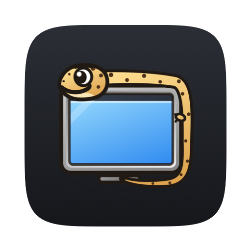
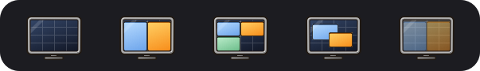
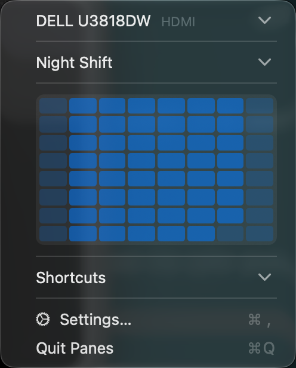
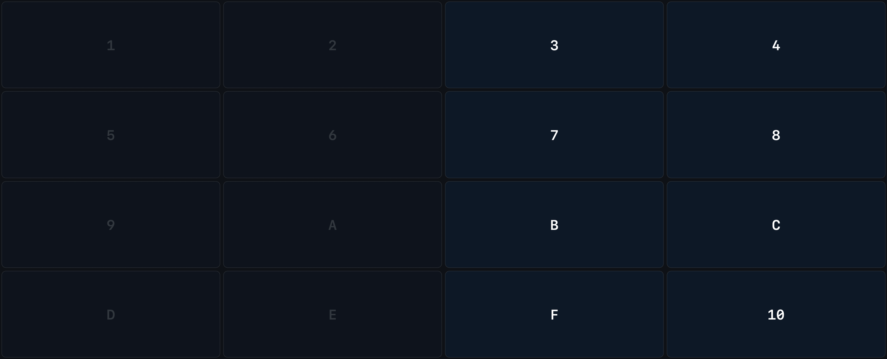
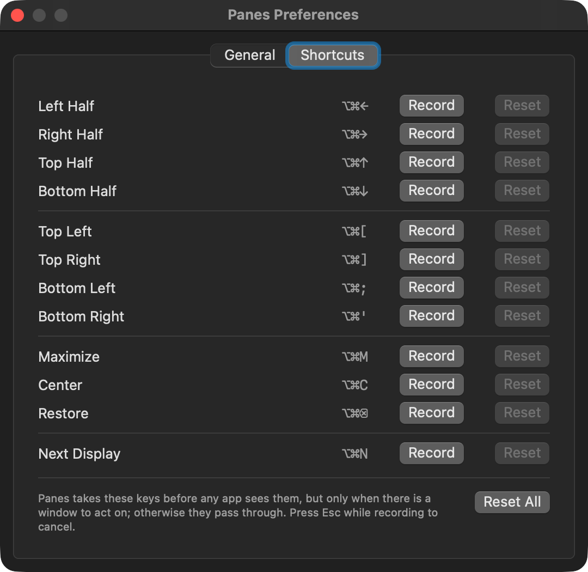

# Panes

<p align="center"></p>

<p align="center"></p>

A standalone macOS menu-bar app for your windows and your displays.

- **Windows**: **global shortcuts** for halves, quarters, maximize, center,
  restore and next display; an **8×8 layout grid** in the menu, and a 4×4
  one over the whole screen while you hold `⌥⌘`; and **edge snapping** when
  you drag a window to a display edge. A replacement for Rectangle.
- **Displays**: an external monitor's brightness, contrast and resolution,
  the keyboard's brightness keys on that monitor, the MacBook's own screen
  from dimmer than macOS allows (Dim) to brighter than it allows (XDR), and
  Night Shift with a sunset-to-sunrise schedule.

**Panes replaces Monitor Lizard.** From 1.0.0 it does everything Monitor
Lizard did; whenever it starts it quits Monitor Lizard if it's running and
turns off its Start at Login, and the first time it also brings its settings
over (see
[Coming from Monitor Lizard](#coming-from-monitor-lizard)). Its mascot is
Monitor Lizard's too: **Armonitor**, the monitor lizard on the app icon.

Its shortcuts are taken by a `CGEventTap` before any app sees them, so an
app that claims the same keys (iTerm2 and ⌥⌘M, say) cannot get in the way,
which is what goes wrong when window shortcuts are set in System Settings.

Built on [StatusItemKit](https://github.com/nicholaspsmith/StatusItemKit) (the
menu-bar shell) and [HotkeyKit](https://github.com/nicholaspsmith/HotkeyKit)
(the global key-tap engine). Part of
[Menumon](https://menumon.nicksmith.software).

**Version 1.11.1** · [Changelog](https://github.com/nicholaspsmith/panes-menubar/releases)

<p align="center"></p>

## Requirements

- macOS 14 or later on Apple Silicon (tested on macOS 27)
- **Accessibility** permission, to move windows and to take the shortcuts and
  the brightness keys
- **Location** (optional), only for a Night Shift schedule that follows
  sunset and sunrise; without it the main city of your time zone is used
- **Notifications** (optional), only asked the first time Panes needs to tell
  you a TV-mode fix needs the display reconnected
- Sibling checkouts of `StatusItemKit` and `HotkeyKit` next to this repo (to build)

## What it does

| Shortcut (default) | Action |
|--------------------|--------|
| `⌥⌘←` / `⌥⌘→` | left / right half; from a top or bottom half or quarter, the quarter on that side (see below) |
| `⌥⌘↑` / `⌥⌘↓` | top / bottom half; from a left or right half or quarter, the quarter at that end |
| `⌥⌘[` / `⌥⌘]` | top-left / top-right quarter |
| `⌥⌘;` / `⌥⌘'` | bottom-left / bottom-right quarter |
| `⌥⌘M` | maximize (the visible frame: below the menu bar, beside the Dock) |
| `⌥⌘C` | center at half the screen's width (at least 1000 pt), full height; press again for two thirds of the height, centred both ways (see below) |
| `⌥⌘⌫` | restore: undo the last move Panes made to this window (again for the one before) |
| `⌥⌘N` | move to the next display, keeping the window's relative frame |
| hold `⌥⌘` | a 4×4 grid over the screen, numbered 1–10 in hex: click or drag across cells (see below) |
| hold `⌥⌘⇧` | the hold-`⌥⌘` grid in half-cells, 8×8, numbered 1–40 in hex (the menu's grid is always 8×8) |

Each acts on the focused window of the frontmost app. A shortcut is
swallowed only when it applies: with no movable window in front, nothing to
restore, or a single display for Next Display, the key passes through to the
app. Rebind any of them in **Settings… ▸ Shortcuts** (Esc cancels a
recording; a shortcut shared by two actions is flagged in red).

### Center: column, then box

`⌥⌘C` makes the window half the screen's width, centred left to right and
the full height of the screen: a column. On a small display the column is
never narrower than 1000 pt (or the whole width, if the display is narrower
than that), so the window still has room to work in. Press it again and the window is
centred both ways at two thirds of the height: a box. Further presses
alternate column, box, column. A window that isn't in the column (moved by
hand, or by another Panes action) gets the column first.

### Arrows combine

The arrows work like Windows 11's Win + arrows: Panes reads which half or
quarter the window is in now, and each arrow moves one edge. `⌥⌘←` then `⌥⌘↑`
is the top-left quarter; from there `⌥⌘→` is top-right and `⌥⌘↓`
bottom-right. A window that isn't in a half or quarter gets a half: `⌥⌘←`
the left half, `⌥⌘↑` the top half. Pressing toward the side the window is already
on widens it back to that half: `⌥⌘→` on the top-right quarter is the right
half, `⌥⌘↑` on it the top half.

### Grid on hold ⌥⌘

Hold `⌥⌘` on its own (no other key, no mouse button) for a moment (0.35 s by
default) and a dark grid fades in over the front window's display. It covers
exactly the display's visible frame, below the menu bar and beside the Dock,
so each cell sits over the very area a window filling it would take. A 4×4
grid, its cells numbered 1 to 10 in hex (`1`–`F`, then `10`) row by row from
the top-left, shaded like the menu's: click
a cell, or drag across cells, and the front window fills it. The app you
were in keeps focus throughout.

- Let go of `⌥` or `⌘` and it fades out (a drag in progress is dropped).
- Press any key while it is up, a shortcut included, and it
  goes at once; the key does what it always does. Panes never takes `Esc`,
  so `⌥⌘Esc` is still Force Quit.
- A quick `⌥⌘` shortcut never brings it up: any key
  during the hold cancels it until `⌥⌘` is let go.
- Hold `⌥⌘⇧` (from the start, or add `⇧` while it is up) for half-cells;
  drop `⇧` for 4×4 again.

Turn it off, or set the delay, in **Settings… ▸ General ▸ Grid on Hold ⌥⌘**.



### Half-cells

The menu's grid is always half-cells: each 4×4 cell split into its own 2×2,
an 8×8 grid, and holding keys while the menu is open does not change it. On
the hold-⌥⌘ grid, hold `⌥⌘⇧` for the same half-cells. Click one, or drag
across several, to fill that area exactly as with the 4×4 grid; shading
follows the finer cells. On the hold-⌥⌘ grid each half-cell shows its number, smaller than on the
4×4 grid: 1 to 40 in hex, row by row from the top-left (`1`–`8` across the
top, `9`–`10` the next row, down to `40` bottom-right). The numbers are only a
guide; no key types them. Let go of `⇧` to return to 4×4. `⌥⌘⇧` on its own is never taken from apps
and never starts a chord.

<p align="center"></p>

### The menu

(Pictured at the top of this page.)

Clicking an item leaves the menu open, so you can try one layout after
another. The exceptions are Quit and the items ending in "…", which open a
window (Settings…, Schedule…). Each section starts folded
under its heading, the chevron pointing down while folded and up while open.

- **One section per display** (see [Displays and brightness](#displays-and-brightness)),
  then **Night Shift** with its Warmth slider and **Schedule…** (see
  [Night Shift](#night-shift)).
- **The layout grid**: the display the front window is on, cut into 8×8
  [half-cells](#half-cells), as wide as the separator lines above and below
  it and roughly as tall as the display's shape (unlabelled).
  Click a cell and the window fills it; drag across cells and the selection
  highlights as you go, and the window fills it on release (a 4×8 drag from
  the top-left is the left half).
  Cells under the front window are shaded in the accent colour, cells under
  other windows on that display lightly. The menu stays open and the shading
  follows the window to where it is going.
- **Shortcuts**: the actions, folded under one row each time the menu
  opens. Click it and they open below it, in place, in their four groups
  (halves; quarters; Maximize, Center and Restore; Next Display), each showing
  its shortcut; click it again to fold them away. Clicking an action applies
  it to the window that was in front when the menu opened. Greyed when they
  do not apply (Restore lights up once an action has moved the window).
- **⚠ Grant Accessibility…**: shown only until Panes is trusted.
- **No window to arrange**: shown, greyed, when no movable window is in front.
- **⚠ macOS Edge Tiling Is On…**: shown when Edge Snapping is on and so is
  macOS's own tiling (`com.apple.WindowManager` `EnableTilingByEdgeDrag` /
  `EnableTopTilingByEdgeDrag`; unset means on). Opens Desktop & Dock.
- **Settings…** (⌘,): every setting, in one window (as in Mac Daddy):
  - **General**: Start at Login; **Edge Snapping** (on by default);
    **Brightness Keys** (on by default, see [below](#brightness-keys));
    the menu-bar **Icon** and, for a meter, its colour (see
    [The icon](#the-icon)); **Grid on Hold ⌥⌘** (on by default) and how
    long to hold (see [below](#grid-on-hold-)); then the version.
  - **Shortcuts**: rebind each action.
- **Quit Panes** (⌘Q).

### Edge snapping

Drag a window by its title bar to a display edge: left or right for that
half, the top to maximize, within 40 pt of a corner for that quarter (the
bottom edge snaps only at its corners). A translucent preview shows the
target while the cursor is there; release to snap, or move away to cancel.
An edge another display sits against is not an edge, so dragging a window
across to the next display never snaps on the way.

### Animation

Every move (shortcut, grid, snap, restore) glides there, eased in and out
over 0.26 s (about as long as macOS's own tiling), stepping once per refresh
of the display the window lands on: 120 times a second on a ProMotion panel,
60 on most external monitors. It is time-driven, so an app slow to apply
Accessibility sets gets fewer, larger steps rather than a late stutter, and
one too slow for four steps jumps straight there. A glide always finishes,
even if its display sleeps or is unplugged mid-move. Reduce Motion jumps
every time. Each move ends with an exact
size, position, size, then a re-read: a window that refuses the size (a
minimum width, a terminal snapping to cells) is nudged back against the edges
its target hugged, so a too-wide right half stays flush right.

A window you tiled with macOS's own tiling (the green button's menu, Window ▸
Fill or Move & Resize) stays in macOS's tile while it is moved around inside
that tile, and macOS puts it back there whenever Mission Control closes or a
display wakes. So before moving one to somewhere inside its tile (Fill to a
half, a half to its quarter), Panes runs the app's Window ▸ Move & Resize ▸
Return to Previous Size, waits the 0.4 s macOS takes to animate that, and
then glides. A move out of the tile glides straight away: macOS forgets the
tile by itself once the window leaves it.

## Displays and brightness

The menu opens with one section per display, headed by its name, then
Night Shift for the whole Mac. Each section starts folded under its
heading; click the heading to open it, and Panes remembers which you
opened (per display):

| Row | What it does |
|-----|--------------|
| **Brightness** | Sets the monitor's own backlight over DDC/CI, like pressing its front buttons. Also works for displays macOS dims itself (TVs over HDMI, Apple and some USB-C monitors: the ones the keyboard brightness keys already work on). |
| **Contrast** | Same, for contrast. |
| **Resolution** | Drag through the sharp HiDPI "looks like" sizes. The `▸` submenu lists every mode. |
| **Brightness** (built-in screen) | One slider for the whole range. The bottom fifth is **Dim**, past the lowest brightness macOS offers. The middle is macOS's own range. With **XDR Brightness** on, the top fifth brightens past full. The brightness keys walk the same ladder. |
| **XDR Brightness** | Built-in XDR panel only: extends the Brightness slider and the brightness-up key past full, into the panel's HDR headroom. Off at every launch. See [XDR brightness](#xdr-brightness). |
| **✓ / ⏳ / ✗ line** | Whether Night Shift works on that display. See [Night Shift on a monitor macOS thinks is a TV](#night-shift-on-a-monitor-macos-thinks-is-a-tv). |

Sliders apply live as you drag. Displays are never polled, and Panes stores
no display settings (only the Night Shift schedule): the monitor keeps its
own brightness and macOS keeps the rest. Dim and XDR brightness are off
every time Panes starts.

Quit BetterDisplay, MonitorControl or any other DDC tool: two apps talking
to one monitor at once interfere with each other.

### Brightness keys

macOS only lets the brightness keys dim the built-in panel. With
**Settings… ▸ Brightness Keys** on (the default), Panes catches the plain
brightness keys:

- **Main display is an external monitor it can drive**: it steps that
  monitor's brightness in sixteen steps across the range, by the same route as
  its Brightness row (DDC, or DisplayServices for a monitor that refuses DDC
  but that macOS can dim), and swallows the key. With Armonitor as the icon,
  he flicks his tongue as the change lands.
- **Main display is the built-in panel, or a monitor nothing can drive**: the
  key passes through to macOS, except that at the built-in panel's lowest lit
  step brightness-down enters [Dim](#dim) instead of switching the screen off.
  After the deepest dim step the next press switches it off; brightness-up
  walks back the same way. With XDR Brightness on, brightness-up past full
  steps into the boost in four +25% steps.

Holding a key repeats. `Ctrl` + brightness is never touched, so
[KeyLight](https://github.com/nicholaspsmith/keylight-menubar) keeps it for the
keyboard backlight. Panes listens for the media-key event an Apple keyboard
sends, which is also what KeyLight posts for F1/F2 on a third-party keyboard,
so both kinds of keyboard work without the apps knowing about each other. The
keys use the same Accessibility grant as the window shortcuts.

### Dim

On the built-in panel every brightness from macOS's lowest key step (1/16)
down to just above zero gives the same 1-nit backlight, and zero switches it
off. **Dim** (the bottom fifth of the built-in Brightness slider) goes darker
by laying a click-through black overlay over the panel. The keys walk it in
five steps letting through 81, 66, 53, 43 and 35% of the light; the slider
covers the same range smoothly, with a readout such as "Dim 53%". The key
ladder is macOS's steps down to 1/16, then the five dim steps, then off; up
from off returns to the deepest dim step.

The overlay covers everything, menus and the menu bar included. It takes no
clicks, follows you into every Space and full-screen app, and is left out of
screenshots and recordings; the pointer stays at full brightness. It goes when
Panes quits and is off every time Panes starts. Raising the brightness
another way (Control Center, auto-brightness) cancels it. Dim and XDR never
apply at once.

### XDR brightness

On a MacBook Pro with an XDR panel, **XDR Brightness** (under the built-in
display) extends the built-in Brightness slider: its top fifth pushes the
whole screen past the normal ceiling, up to twice SDR white, using the
panel's HDR headroom. The readout says "XDR +50%" and so on. It works on M5
Macs, where Monitor Lizard's version could not (macOS 27 ignores the
brightness table it wrote on an M5 Pro/Max panel, Apple FB22273730).

Panes lays a full-screen, click-through EDR layer over the panel, as
BrightIntosh does: the layer puts the panel into HDR mode, and the window
server multiplies everything beneath it into the headroom the panel grants.
The headroom ramps up over about two seconds and moves with brightness, and
the boost follows it. Like Dim's overlay it joins every Space and is left
out of screenshots.

The headroom only exists on an XDR preset. On "Apple Display (P3-600 nits)"
and the other SDR presets the toggle is greyed, and a line under it says
**Set Displays ▸ Preset to Apple XDR Display (P3-1600 nits)** (System
Settings ▸ Displays ▸ Preset).

The overlay is closed before sleep, when the displays sleep, on quit and
whenever the display setup changes (lid closed, monitor plugged in), and
comes back only once things settle. Being a window, it goes with the app, so
even a crash cannot leave a boost behind. It is never applied to external
displays and is off every time Panes starts.

On battery, XDR Brightness switches off and the menu shows "XDR Brightness ·
off on battery" until you plug in. To allow it on battery:
`defaults write com.nicholaspsmith.Panes xdrOffOnBattery -bool false`.

Side effects: HDR video can clip its brightest highlights while it is on, and
the panel draws more power and runs warmer.

## Night Shift

In the menu's **Night Shift** section, **Enabled** turns it on and off,
**Warmth** sets how warm it is, a grey line says when the schedule next
switches it ("On at 9:00 PM"), and **Schedule…** opens a small window:

- **Turn on**: at sunset, or at a set time. Sunset can be moved up to three
  hours either way ("30 min before sunset").
- **Turn off**: at sunrise, or at a set time, with the same offsets.
- Each sun-based row shows the next sunset or sunrise and the time Night
  Shift will actually switch, offset included.
- **Ramp the warmth**: Night Shift starts with no warmth and climbs to the
  Warmth slider's setting over the first 15 min to 3 h, then fades over the
  same span before it turns off. While the ramp runs, the Warmth slider sets
  the warmth it climbs to.

The line under Schedule… says when Night Shift next turns on or off.
Switching Night Shift by hand (from the menu or Control Center) holds until
the schedule's next on or off time. Turning the schedule on turns off macOS's
own Night Shift schedule, so the two never fight. Set times need no location.

Sunset and sunrise come from the Mac's location. Panes saves the place it
finds and asks Location Services again only when it has no saved place, the
saved one is more than 30 days old, your time zone changes, or you open
Schedule…. If Location is denied, the saved place keeps working; with no
saved place, the main city of your time zone is used.

### Night Shift on a monitor macOS thinks is a TV

macOS turns Night Shift off on any display it thinks is a **television**, and
it thinks that about plenty of ordinary monitors plugged in over HDMI. Panes
spots that, asks for your password **once**, and writes a small override
telling macOS the display is a monitor. Unplug and replug the display (or
reboot) and Night Shift works on it from then on. Panes does not need to be
running for the fix to hold.

## The icon

**Settings… ▸ Icon** picks what sits in the menu bar, from a row of tiles that each show the icon as it would look there:

- **Screen Grid** (the default): the windows on your display, as tiles.
- **Major Pane**: the commander of windows, his pane lit where the front
  window sits.
- **Armonitor**: the monitor lizard on his monitor, showing the main
  display's brightness and Night Shift.
- **Arc, Gauge**: plain meters of the main display's brightness, in the
  colour picked below them. (Pie and Wedge went in 1.11.0; a saved choice of
  either shows Arc.)

**The Screen Grid** is a little display in the Menumon glyph style (shaded
bezel on a stand, dark glass, ink outlines), shaped like the display the icon
sits on, with a faint 4×4 grid. Every window on that display is drawn on it as
a small tile at its true scaled position and size, whether or not it fits the
grid, back to front with outlines so overlaps read; the frontmost window is
amber, the others soft blues, greens and lilacs. It greys out while
Accessibility is not granted. In Panes's turn in the Menumon minute cue
(StatusItemKit's `MinuteCue`), twice a minute, the windows on the display
bunch up in the middle and slide out into their tiles, the front one glowing
as it lands. Not under Reduce Motion, and not on an empty display.

The window list comes from `CGWindowListCopyWindowInfo` (bounds only, which
needs neither Accessibility nor Screen Recording). The icon redraws when an
app activates, the Space or the displays change, after Panes moves a window,
and on a 1.5 s poll that redraws only when the bounds list has changed.

Whichever icon is chosen does Panes's turn in the minute cue: the grid's
tiles slide, Major Pane salutes, Armonitor runs a lap of his monitor. None of
them moves under Reduce Motion.

## Armonitor

Panes's mascot is **Armonitor**, the monitor lizard Monitor Lizard brought
with it: a spotted yellow lizard wrapped round a little monitor. He is the app
icon (drawn large on the dark tile every Menumon app shares) and one of the
menu-bar icons. As the icon, the screen fills with blue as the main display
gets brighter and turns amber while Night Shift is on, and he flicks his
tongue when a slider or key change lands on the monitor.

In Panes's turn in the minute cue he runs a lap of his monitor (3 s). He also
runs a lap of the whole screen (about 3.4 s) when Panes starts, when a display
it has not seen before is connected, and when Night Shift turns on or off
(from the menu, Control Center or its schedule); sliders never trigger it.
The lap plays in a click-through overlay, so nothing under it stops working.
Both laps happen only while Armonitor is the chosen icon, and never under
Reduce Motion.

## Major Pane

**Major Pane**, Panes's mascot before 1.0.0 and now one of its icons, is a
commander of windows: blond flat-top, square jaw, dark shades, chest out,
holding his pane in front of him like a riot shield, a fist round each edge;
the pane is the size of the Screen Grid icon and ruled into a faint 4×4 grid.
He is pixel art, hand-placed on a 29×22 grid with eighteen colours, drawn in
whole pixels at the bar's backing scale so nothing is ever blurred. The
pane's cells light to show where the frontmost app's window sits: eight for a
half, four for a quarter, all sixteen when it is maximized, none when it
floats free, when there is no window, or when that window is on another
display.

He stands at attention (a slow breath, a glint on the shades) and, in Panes's
turn in the Menumon minute cue, snaps a salute. When Panes moves a window he
barks the order and the pane relights to its new tile. Without Accessibility
he stands at ease, pane lowered, greyed out. Under Reduce Motion he holds
still.

<p align="center"></p>

## How it works

- **HotkeyKit** owns the key tap. macOS sets the fn flag on every arrow,
  Home/End, Page Up/Down and Forward Delete event; HotkeyKit drops it there
  (as on the F-keys), so ⌘⌥← binds as ⌘⌥←. While Settings records a shortcut,
  the tap lets keys through to the recorder. The tap is re-created every 6 s
  to stay ahead of taps other apps add later.
- **The hold-⌥⌘ grid** rides on the same tap: its `onModifiersChanged`
  reports every modifier change and `onKeyDown` every key press, and neither
  takes anything. `HoldGrid` in PanesCore decides when the grid shows and
  goes; the grid view is shared with the menu.
- **Accessibility** (`AXUIElement`) reads and sets the focused window's
  position and size (messaging timeout 0.3 s, so a hung app cannot stall the
  tap). Only standard windows and dialogs whose position is settable, not
  minimized and not full screen, are moved. `AXEnhancedUserInterface` is
  switched off on the app during a move and put back (it makes Chromium and
  Electron apps animate every set). Restore history is keyed by the window's
  `CGWindowID` (`_AXUIElementGetWindow`).
- **Coordinates**: all frame math happens in AX space (origin at the top-left
  of the primary display, y down, so a display left of the primary has negative
  x and one above it negative y). `NSScreen` frames and the cursor are flipped
  in once with the primary display's height.
- **Edge snapping** uses global mouse monitors (no permission needed for mouse
  events). A press on a window becomes a snap drag once that window has moved
  without changing size, which tells a title-bar drag from a resize or a drag
  inside the content.
- **PanesCore** holds the testable logic: frames for every action on any
  display layout, the center column and box, the grid's hex numbers, the relative move between displays, the fit-after-refusal
  nudge, snap zones, restore history, the grid, the frame interpolation and
  pacing, the icon's window mapping and pixel alignment, bindings and their
  formatting. **PanesGlyph** draws the Screen Grid and Major Pane, shared by
  the app and the Menumon site's renderer. Armonitor and the meters are
  StatusItemKit's (`CharacterIcon.monitorLizard`, `MeterIcon`).
- **Glides** step on a display link of the screen the window lands on, at its
  refresh rate (`NSScreen.maximumFramesPerSecond`). A timer a quarter second
  past the glide's length finishes it if that link stops (the display slept
  or went away), so the window always lands and Enhanced UI is always put back.
- **Brightness and contrast** go over DDC/CI through `IOAVService`, the
  private IOKit interface every Apple Silicon DDC tool uses. One serial queue
  per display, every read confirmed by checksum.
- **Built-in screen brightness** uses DisplayServices, as does any external
  display macOS says it can dim itself (`DisplayServicesCanChangeBrightness`)
  once a DDC read has failed on it. That is the route the keyboard keys take.
- **Brightness keys** come through HotkeyKit's `CGEventTap`, bound to the two
  brightness media keys with no modifiers. They step the main display over
  whichever route its Brightness row uses, DDC or DisplayServices. On the
  built-in panel they pass through to macOS down to 1/16, then drive Dim.
- **Dim** is a borderless black `NSWindow` per built-in panel at
  `.screenSaver` level, click-through, `sharingType = .none`, joining every
  Space. Its opacity is `1 − 0.35^level`. (Gamma tables scaled below 1 change
  nothing visible on this panel, in SDR or HDR, so Dim cannot use one.)
- **XDR brightness** is a borderless, click-through window per built-in panel
  whose `CAMetalLayer` asks for EDR and draws one uniform value with a
  multiply compositing filter (`EDRMultiplyOverlay`). No transfer or gamma
  table is written, so nothing outlives the process.
- **Night Shift** uses CoreBrightness. The schedule's place comes from Core
  Location (When In Use), saved with the date it was found.
- **The "is this a TV?" flag** comes from CoreDisplay, the same source
  `system_profiler` reads. **The TV fix** is a plist at
  `/Library/Displays/Contents/Resources/Overrides/DisplayVendorID-<hex>/DisplayProductID-<hex>`
  containing `DisplayIsTV = false`; macOS reads it when the display attaches.
- **DisplayCore** holds the displays' testable logic (Monitor Lizard's core):
  DDC and its retries, display matching and modes, the built-in slider's
  Dim/macOS/XDR ladder, the XDR policy, Night Shift's schedule and sun times,
  the Location policy, the lap trigger and the Monitor Lizard migration.

## Install

```sh
./install.sh
```

Builds `Panes.app`, symlinks it into `~/Applications`, and launches it. Grant
**Accessibility** when prompted. On a Mac that parity
keeps in sync, it hands the install to parity instead (`PARITY=off
./install.sh` builds locally).

### Make the Accessibility grant survive rebuilds (recommended)

An ad-hoc signed build gets a new code hash on every rebuild, and macOS drops
the Accessibility grant. Create a stable local signing identity **once**; the
build script uses it whenever it exists:

```sh
../StatusItemKit/scripts/setup-signing.sh   # one-time, idempotent
./install.sh                                # rebuild signs with it
```

**If the shortcuts stop working after a rebuild**, the grant went stale:
re-approve Panes in System Settings ▸ Privacy & Security ▸ Accessibility. If it
is already on but inert, clear the stale entry and re-grant:

```sh
tccutil reset Accessibility com.nicholaspsmith.Panes
open ~/Applications/Panes.app
```

### Start at Login (optional)

Toggle it in **Settings… ▸ Start at Login**, or from the shell:

```sh
"$HOME/Applications/Panes.app/Contents/MacOS/Panes" --login on       # or: off, status
```

### Coming from Monitor Lizard

Nothing to do by hand. Every time Panes starts it checks for Monitor Lizard;
if it is running, Panes asks it to quit (forcing it after a few seconds) and,
if it is installed, turns off its Start at Login, so there is only ever one
icon and one app driving the displays. Monitor Lizard clears its own Dim and
XDR as it quits.

Once, after that, Panes copies Monitor Lizard's settings into its own:
Brightness Keys, XDR's off-on-battery choice, the Night Shift schedule, its
warmth and saved place, and the meter colour. A setting Panes already has is
never overwritten. A meter icon (Arc or Gauge; Pie and Wedge become Arc) carries over as
Panes's icon if you had not picked one; Armonitor does not, so the Screen
Grid stays the default (pick Armonitor in **Settings… ▸ Icon** to keep him in the bar).
Monitor Lizard's own settings are left where they are.

### Coming from Rectangle

Quit Rectangle (and remove it from Login Items) before relying on Panes: both
would take the same keys and both would snap at the edges. Clear any window
shortcuts set in System Settings ▸ Keyboard ▸ Keyboard Shortcuts ▸ App
Shortcuts too, and turn off macOS's own edge tiling in Desktop & Dock (the
menu warns while it is on).

## Develop

```sh
swift build                    # compile
swift test                     # PanesCore, DisplayCore and PanesGlyph unit tests (no display needed)
scripts/make-icon.sh           # Resources/bundle/AppIcon.icns and docs/mascot.png
python3 art/major-pane/build_frames.py && python3 art/major-pane/render.py   # the art → frames.json, review renders in art/major-pane/out/
scripts/gen_major_pane_frames.py art/major-pane/frames.json                 # → Sources/PanesGlyph/MajorPaneFrames.swift (a test fails if stale)
swift run major-pane-render preview out.html [--frames FILE]                 # every clip animating, the review page
```

Major Pane is drawn in `art/major-pane/build_frames.py`, every pixel in code;
`render.py` makes contact sheets and an animated sheet to check it, and the
generator compiles it into Swift. The concept sketches in `art/mascot/` are
guide only.

```sh
log show --last 5m --predicate 'subsystem == "com.nicholaspsmith.Panes"' --style compact
```

The displays log under the categories `ddc`, `modes`, `nightshift`, `tvrole`,
`menu`, `xdr` and `migration`.

Every Menumon app's pictures are rendered from its own drawing code by the
[Menumon site](https://github.com/nicholaspsmith/widgets.nicksmith.software)'s
`art/glyphs`, which compiles `PanesGlyph` with the PanesCore types it needs.
`scripts/make-icon.sh` runs its `app-icons.sh` for Panes alone (needs that repo
and StatusItemKit checked out beside this one), drawing Armonitor on the tile;
its `render-glyphs.sh` draws `docs/menubar-icon.png` (the Screen Grid's
states) and `docs/animation.png` along with every other app's pictures.

## Releasing

Every push to `main` is a release. Before pushing, add a dated
`## [X.Y.Z] - YYYY-MM-DD` section to the top of [`CHANGELOG.md`](CHANGELOG.md)
(minor for features, patch for fixes; turn a waiting `## [Unreleased]` into
it). When it reaches `main`, GitHub tags `vX.Y.Z` and publishes the section as
a release titled `vX.Y.Z`. Without a new version:

- a push is refused locally by the `pre-push` hook;
- a pull request **cannot merge** — `release / check` is required on `main`;
- a push that reaches `main` anyway fails the release workflow.

The one exception is `[no release]` in the tip commit's message, for changes
nothing a user runs (setup, CI, developer docs): it passes every check with no
version bump and no tag. Never tag or create a release by hand, and never
`gh pr merge --admin` past a failing check — fix the PR. After merging,
`git pull` for the tag, rebuild (the menu's version row is stamped from it),
and update the version line at the top of this README. `install.sh` re-arms
the hook on a fresh clone. See
[StatusItemKit — Releases](https://github.com/nicholaspsmith/StatusItemKit#releases-every-push-is-one)
for the whole rule.

## Why not a SwiftBar plugin?

This is a standalone `.app` built on [StatusItemKit](https://github.com/nicholaspsmith/StatusItemKit), not a script under a plugin host: no SwiftBar to install, a real AppKit menu (a live layout grid, sliders that apply as you drag) instead of rendered stdout, event-driven updates instead of a re-run timer, global key taps and overlays a script cannot hold, and an icon that keeps its place in the bar.

## The menu-bar suite

A suite of macOS menu-bar apps that share one framework, one build-and-sign
script and one installer, built to sit in the same bar: consistent menus, a
common **Icon** picker, and cooperative hiding so no icon strands another.

| App | What it does |
|---|---|
| [Claude Usage](https://github.com/nicholaspsmith/claude-usage-menubar) | Claude Code plan limits, resets, and live agent sessions |
| [Apollo Monitor](https://github.com/nicholaspsmith/apollo-monitor-menubar) | Apollo audio-interface monitor level |
| [Battery Time](https://github.com/nicholaspsmith/battery-time-menubar) | Time remaining, power mode, and 24h usage |
| [VPN & DNS](https://github.com/nicholaspsmith/vpn-dns-menubar) | An iguana for Mullvad + Tailscale state, with a DNS watcher |
| [Mac Daddy](https://github.com/nicholaspsmith/mac-daddy-menubar) | Kills media trackers, trashes stale downloads, reaps hung processes, watches the UA mixer engine, sweats as your process count climbs, and (optionally) a ⌘Space launcher for apps, arithmetic, unit conversions and emoji |
| [KeyLight](https://github.com/nicholaspsmith/keylight-menubar) | Ctrl+brightness keys remapped to keyboard backlight |
| [Homestead](https://github.com/nicholaspsmith/home-assistant-menubar) | Home Assistant dashboards and device controls in the menu |
| [SoundChain](https://github.com/nicholaspsmith/soundchain-menubar) | One chain of Audio Unit effects over all system audio |
| **Panes** | Window shortcuts, a layout grid and edge snapping; external-monitor brightness, contrast and resolution, the brightness keys, Night Shift, and the built-in screen from dimmer than macOS allows to XDR (replaces Monitor Lizard) |
| [MacRecorder](https://github.com/nicholaspsmith/MacRecorder) | Screen recording with system audio |
| [Barn](https://github.com/nicholaspsmith/menubar-barn) | macOS 26 and earlier only: hides a block of status icons by width (on macOS 27, use System Settings ▸ Menu Bar) |

| Framework | |
|---|---|
| [StatusItemKit](https://github.com/nicholaspsmith/StatusItemKit) | Status-item lifecycle, polling, menus, meter and mascot icons, the shared Icon picker |
| [HotkeyKit](https://github.com/nicholaspsmith/HotkeyKit) | CGEventTap engine for intercepting and remapping global keys |

Install the whole suite on a fresh Mac with
[macOS Dev Environment Setup](https://github.com/nicholaspsmith/MacOS-Dev-Environment-Setup):

```bash
git clone https://github.com/nicholaspsmith/MacOS-Dev-Environment-Setup.git
cd MacOS-Dev-Environment-Setup && ./bootstrap.sh --all
```

## License

Copyright (c) 2026 Nicholas Smith. Licensed under the
[Mozilla Public License 2.0](LICENSE). You may use, modify, sell and
redistribute this software, including inside proprietary products, provided
the copyright notice and license stay on these files and any modified
versions of them are made available under the same license.

The Major Pane artwork (everything under `art/`, the generated
`Sources/PanesGlyph/MajorPaneFrames.swift`, and `docs/animation.png`, the one
picture in `docs/` that shows him) is [CC BY-NC 4.0](art/LICENSE): see
[NOTICE](NOTICE). It may not be used commercially. The app icon
(`Resources/bundle/AppIcon.icns`), `docs/mascot.png` and
`docs/menubar-icon.png` show Armonitor and the Screen Grid, drawn by
MPL-licensed code, and fall under the Mozilla Public License 2.0 with the rest.
